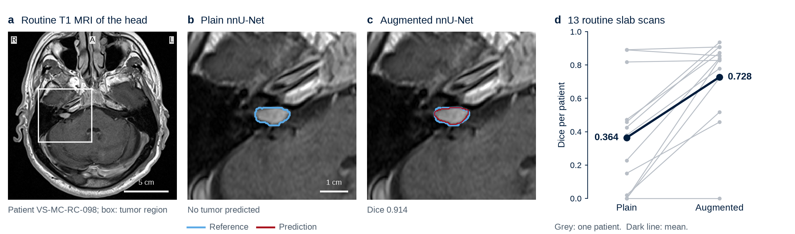
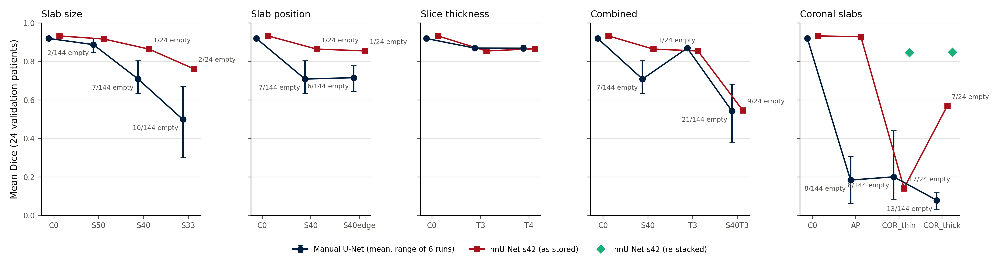
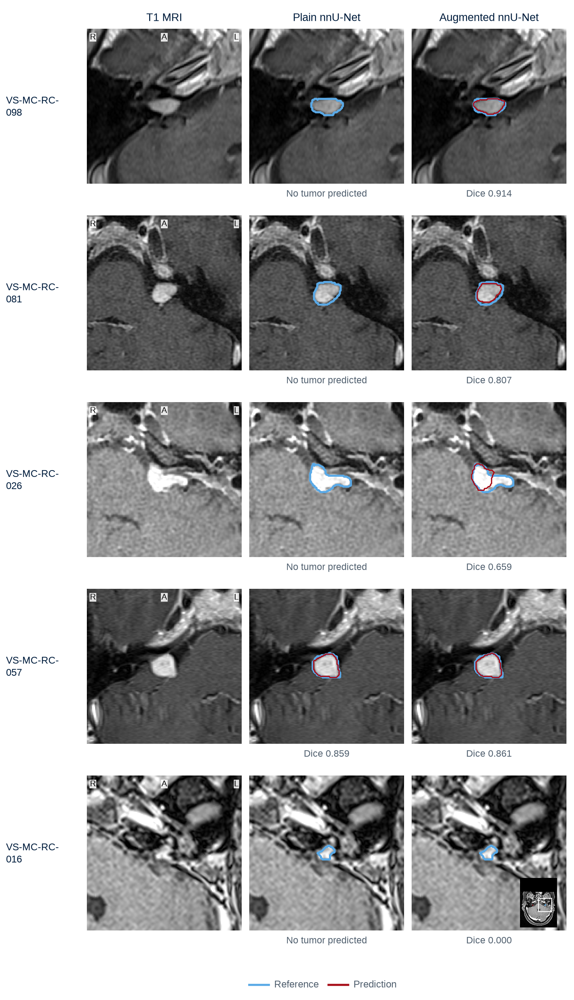

# Deep Learning for Vestibular Schwannoma Segmentation: Evaluating Cross-Dataset Generalization

Code and experiment records for the MSc thesis of the same title by
Kristian Svendsen, University of Bergen, 2026.

  

*(a) Axial slice of a routine T1 MRI of the head with a vestibular schwannoma
(boxed). (b, c) The boxed region with the reference outline in light blue and
the model prediction in red (models with seed 42). (d) Dice for each of the 13
routine slab scans under plain and augmented training (mean of two seeds
each); the dark line is the mean. One patient is still missed after
augmentation.*

The thesis asks why T1 MRI segmentation models for vestibular schwannoma (VS)
that were trained on the standardized VS-SEG dataset fail on routine
multicenter T1 MRI (VS-MC-RC), and whether targeted training on the existing
data can reduce those failures. This repository holds the training and
evaluation code, the protocols that were committed before the experiments ran,
and the score tables behind the reported results. It contains no MRI volumes,
segmentation masks or model checkpoints.

The repository is a single snapshot of the code and records at thesis
submission in November 2026. The work was developed in a private repository.
Its commit history is not published and is available on request.

## Research questions and the three steps

| | Question | Step |
|---|---|---|
| **RQ1** | Where does generalization break down? How far does a VS segmentation model trained on standardized T1 MRI from VS-SEG carry over to routine clinical T1 scans from VS-MC-RC? | **Step 1: establish the pipeline and measure transfer.** Six manual 3D U-Net runs (baseline and lower dropout, seeds 42–44) and one nnU-Net run, all trained on the same 193 VS-SEG patients and scored in common on 24 validation and 22 MC-RC patients. |
| **RQ2** | What in the images causes it? Which image properties define the cases where the model fails? | **Step 2: identify what breaks the model.** Orientation audit with a post hoc re-stacked rerun, whole-head versus slab strata, and a controlled stress test (eleven conditions) on the 24 validation patients, with no retraining. |
| **RQ3** | Can it be fixed with the data we already have? Can a change to the training scheme, using only the existing training data, remove these failures? | **Step 3: retrain on targeted variation in the same data.** A pre-registered comparison of plain and slab/thick-slice-augmented nnU-Net, two seeds per arm, with the nnU-Net configuration held fixed. Primary endpoint: 13 MC-RC slab acquisitions. |

An exploratory comparison with a tool-using LLM agent supports RQ2 in the
thesis. Its records are kept outside this repository.

## Headline results

All values are volume-level Dice, as reported in the thesis.

**Step 1 (RQ1).** Across the seven initial runs, validation mean Dice was
0.917–0.932 (24 patients) against 0.367–0.483 on the 22 external patients,
with 6–12 external cases below Dice 0.1 per run. For nnU-Net the external
mean/median was 0.483/0.679, and seven external predictions were empty.

**Step 2 (RQ2).** Four non-axial scans reached nnU-Net with their axes ordered
differently from training. Correcting this post hoc raised the external
mean/median to 0.543/0.788. The original nnU-Net scored 0.892 on seven axial
whole-head scans and 0.342 on eleven axial slabs. On the 24 validation
patients, a nominal 40 mm slab with 3.3 mm slices reduced nnU-Net mean Dice
from 0.932 to 0.546, with nine empty predictions.

  

*Stress test on the 24 validation patients, with no retraining. C0 is the
unchanged scan; S50, S40 and S33 are slabs of nominally 50, 40 and 33 mm; T3
and T4 are 3 mm and 4 mm slices; S40T3 combines a 40 mm slab with 3.3 mm
slices; the last panel simulates coronal slabs. Labels give the number of
empty predictions.*

**Step 3 (RQ3).**

| Evaluation | Plain nnU-Net | Augmented nnU-Net |
|---|---:|---:|
| 13 MC-RC slab cases (primary), mean / median | 0.364 / 0.379 | 0.728 / 0.834 |
| All 22 MC-RC patients, mean / median | 0.546 / 0.621 | 0.761 / 0.850 |
| Seven axial whole-head MC-RC cases, mean | 0.898 | 0.897 |
| VS-SEG validation (24), mean | 0.929 | 0.934 |
| Reserved internal test (24), unchanged scans, mean | 0.916 | 0.935 |
| Reserved internal test (24), simulated 40 mm slab with 3.3 mm slices, mean | 0.579 | 0.885 |

Values are two-seed arm averages of separately trained models on re-stacked
inputs, not ensemble masks. On the primary endpoint the paired mean difference
was +0.364 (95% CI 0.214–0.513), which met the pre-registered benefit rule;
empty predictions fell from 10 to 1 of 26 patient/model outputs per arm. The
source-validation check required the augmented mean to be no more than 0.01
below the plain mean, and passed.

  

*Five MC-RC slab patients: image, plain nnU-Net and augmented nnU-Net (both
seed 42, re-stacked inputs). Light blue: reference. Red: prediction. The plain
model returned an empty prediction for four of them; the augmented model
segmented three of those and scored 0 on VS-MC-RC-016. Image slices are derived
from VS-MC-RC (CC BY 4.0; see Data).*

**Limits stated in the thesis.** The MC-RC cases had been inspected before the
intervention was designed and informed its ranges, so the improvement requires
confirmation on an independently reserved cohort. The orientation correction
was post hoc. Targeted training reduced the observed failures but did not
remove all of them, and source-validation false-positive components increased
after augmentation. The internal-test difference on unchanged scans is read as
no detectable harm, not as a gain.

## Repository map

| Path | Contents |
|---|---|
| `src/` | Manual 3D U-Net pipeline: settings (`config.py`), patient-list and file-hash guard (`data.py`), preprocessing and patch sampling (`dataset.py`), training (`train.py`), run records (`run_logging.py`), and prediction export plus the common scorer used for both pipelines (`evaluate.py`). |
| `experiments/` | [Experiment guide](experiments/README.md) with the design and commands, manual settings (`settings.json`), the patient partition and file hashes (`data_lock.json`), run launcher (`run.py`), Slurm scripts, nnU-Net preparation, and the augmentation trainer (`nnunet_trainers/nnUNetTrainerSlabThick.py`). |
| `analysis/` | Failure analysis and stress test (`model_insight.py`, `model_insight.slurm`) with its case-figure helper (`make_case_figure.py`), the original comparison statistics (`thesis_analysis.py`), the scan-overlap audit (`audit_mcrc_vsseg_scan_overlap.py`), and the dated evidence under `analysis/reports/`; see the [report index](analysis/README.md). |
| `metadata/` | Patient lists, scanner assignments, tumor volumes and the 22-patient external cohort table. Tables only; no images. |
| `tests/` | Checks for scoring, prediction export and the nnU-Net runtime. |
| `docs/` | The three figures shown on this page and the script that makes them (`make_readme_figures.py`). They are display versions in one blue and red palette; the thesis versions under `analysis/reports/` use blue and orange and are unchanged. |
| `requirements/`, `requirements.txt` | Python package lists for the analysis and preprocessing helpers. |

`data/`, `outputs/`, `logs/` and the `work/` directories are local and are not
part of the repository. Dated reports keep the commands, paths and hashes that
applied when they were written; some of them point to local files or to
reports that are not distributed here.

## Where the reported results come from

| Thesis part | Records | Code |
|---|---|---|
| Design, partition and settings | [`experiments/README.md`](experiments/README.md), [`experiments/settings.json`](experiments/settings.json), [`experiments/data_lock.json`](experiments/data_lock.json) (193 training, 24 validation, 24 reserved test; VS-SEG-159 excluded) | `experiments/run.py`, `src/data.py` |
| External cohort: 51 candidates reduced to 22 | [`analysis/reports/trustworthy_testing_20260907/REPORT.md`](analysis/reports/trustworthy_testing_20260907/REPORT.md), `metadata/evaluation/mcrc_t1_patient_independent.csv` | |
| Scan-level overlap between VS-MC-RC and VS-SEG | [`analysis/reports/mcrc_vsseg_scan_overlap_20261103/`](analysis/reports/mcrc_vsseg_scan_overlap_20261103/REPORT.md): `REPORT.md`, `patient_classification.csv`, `same_acquisition_pairs.csv`, `summary.json` | `analysis/audit_mcrc_vsseg_scan_overlap.py` |
| VS-SEG source and reference checks | [`analysis/reports/vsseg_t1_readiness_mvp/REPORT.md`](analysis/reports/vsseg_t1_readiness_mvp/REPORT.md) | |
| Step 1: seven-run comparison on validation and MC-RC | [`analysis/reports/t1_evaluation_20260912/`](analysis/reports/t1_evaluation_20260912/README.md): `runs.csv` (checkpoints and hashes), the two patient manifests, `patient_scores.csv` (322 patient/run records), `results.csv` | `src/evaluate.py`, `experiments/prepare_evaluation.py`, `experiments/evaluate.slurm` |
| Step 1: original comparison statistics from the patient scores | `analysis/reports/thesis_statistics_20261008/statistics.json` | `analysis/thesis_analysis.py` (`analyse`) |
| Paired pipeline and dropout differences | `analysis/reports/model_insight_20261012/paired_bootstrap.json` | `analysis/thesis_analysis.py` (`paired_bootstrap`) |
| Step 2: orientation and acquisition strata | [`analysis/reports/model_insight_20261012/`](analysis/reports/model_insight_20261012/FINDINGS.md): `orientation.csv`, `nnunet_reoriented_scores.csv`, `cases.csv`, `acquisition_by_outcome.csv` | `analysis/model_insight.py`, `analysis/model_insight.slurm` |
| Step 2: stress test on validation | `analysis/reports/model_insight_20261012/stress_test/`: `perturbations.csv`, `stress_test.csv`, `stress_summary.csv`, `stress_bootstrap.json` | `analysis/model_insight.py` (`stress-*` commands) |
| Step 3: training runs and validation gate | `analysis/reports/model_insight_20261012/`: `followup_training/run_summary.csv`, `followup_checkpoints.csv`, `followup_validation_check.json`, `stress_test/followup_stress_test.csv`, `stress_test/followup_stress_summary.csv` | `experiments/nnunet_trainers/nnUNetTrainerSlabThick.py`, `experiments/train.slurm`, `analysis/model_insight.py` (`followup-*` commands) |
| Step 3: MC-RC primary and secondary results | `analysis/reports/model_insight_20261012/mcrc_followup/tables/per_case.csv` and `summary.csv`; figures in `mcrc_followup/figures/` | `analysis/model_insight.py` (`followup-mcrc`, `followup-figures`), `analysis/make_case_figure.py` |
| Step 3: post hoc robustness, seed stability, false positives, remaining cases | `analysis/reports/model_insight_20261012/mcrc_followup/posthoc/` | `analysis/model_insight.py` (`followup-posthoc`, `followup-fp-figure`), `analysis/make_case_figure.py` |
| Internal-test check | [`analysis/reports/internal_test_20261021/`](analysis/reports/internal_test_20261021/REPORT.md): `REPORT.md`, `bootstrap.json`, `tables/`, `scores/` | `analysis/reports/internal_test_20261021/code/` |

`analysis/thesis_analysis.py` has no command-line entry. Its two functions
take the repository root and an output folder:

- `paired_bootstrap` runs from this repository alone and reproduces
  `paired_bootstrap.json`.
- `analyse` also reads scanner groups from `analysis/reports/per_case_metrics.csv`
  and five nnU-Net cross-validation summaries from the local `outputs/`
  folder. Those summaries are not distributed, so `analyse` does not run to
  completion from this repository alone.

During development `make_case_figure.py` was kept outside the repository. In
this snapshot it sits in `analysis/`, and the one line in `model_insight.py`
that locates it was changed to match.

## Protocols written before the experiments

The protocols were committed to the private development repository before the
corresponding training or inference. They were not submitted to an external
registry; "pre-registered" is used in this sense.

The commit hashes below, the hashes cited in the thesis, and the hashes quoted
inside the records (for example under `analysis/reports/internal_test_20261021/`)
refer to that private history. It is not part of this repository and is
available on request. The two protocol files and the augmentation trainer in
this repository are byte-identical to their versions at `db0521a`, `20901f9`
and `f25e035`.

| Commit | Time (CEST) | What it records |
|---|---|---|
| `db0521a` | 12 Oct 2026, 18:21 | [`PREREGISTRATION.md`](analysis/reports/model_insight_20261012/PREREGISTRATION.md) for the slab/thick-slice augmentation experiment, before smoke tests and full training |
| `f25e035` | 12 Oct 2026 | The augmentation trainer |
| `2302842` | 12 Oct 2026 | The effective slab-range deviation, documented before full training |
| `dd97600` | 13 Oct 2026, 15:32:12 | Evaluation step A: validation check and stress test |
| `450b8af` | 13 Oct 2026, 15:36:24 | Evaluation step B: the 22 MC-RC patients |
| `20901f9` | 21 Oct 2026 | [`PROTOCOL.md`](analysis/reports/internal_test_20261021/PROTOCOL.md) for the internal-test check, before any inference on those patients |

## Data

No images, masks or checkpoints are distributed here. The thesis uses two
published collections:

- **VS-SEG**: 242 patients from a single radiosurgery setting. Shapey et al.,
  *Scientific Data*, 2021, [doi:10.1038/s41597-021-01064-w](https://doi.org/10.1038/s41597-021-01064-w).
- **VS-MC-RC**: routine multicenter MRI, distributed through The Cancer
  Imaging Archive (TCIA) under a CC BY 4.0 license. Kujawa et al., *Frontiers
  in Computational Neuroscience*, 2024,
  [doi:10.3389/fncom.2024.1365727](https://doi.org/10.3389/fncom.2024.1365727).
  The local download corresponded to TCIA version 1 (124 patients, 354 series).

The code expects processed NIfTI volumes under `data/processed/`, with the
relative paths listed in `metadata/`. The exact development files are
identified by the hashes in `experiments/data_lock.json` and in the evaluation
manifests.

Two figures show image slices from VS-MC-RC patients with reference and
predicted outlines: `cases_followup` and `cases_contralateral` (PNG and PDF)
under `analysis/reports/model_insight_20261012/mcrc_followup/`. They are
derived from the VS-MC-RC collection (Kujawa et al., 2024) and are shared
under its CC BY 4.0 license. The banner and the case figure in `docs/` show
slices of the same patients.

## Software environment

Training ran in an ARM64 container on GPU nodes (the primary nnU-Net runtime
record identifies an NVIDIA GH200), with one GPU, 16 CPUs and 128 GiB of
system memory per job. nnU-Net was version 2.8.1.

- `experiments/environment.sh` starts the container for the manual pipeline or
  for nnU-Net.
- `analysis/reports/internal_test_20261021/provenance/` lists the installed
  packages of both environments and the container checksum.
- The Slurm scripts and `environment.sh` contain the absolute paths and the
  compute account of the cluster on which the experiments ran. Change them
  before running elsewhere.

Commands for training, prediction and scoring are in the
[experiment guide](experiments/README.md); the analysis commands are listed at
the top of `analysis/model_insight.py`.

## License

The code and the author's records in this repository are released under the
MIT License; see [LICENSE](LICENSE). The license does not cover the VS-SEG and
VS-MC-RC data, which are not distributed here. The two figures named under
Data, and the two figures in `docs/` that show such slices, remain under CC BY 4.0.
